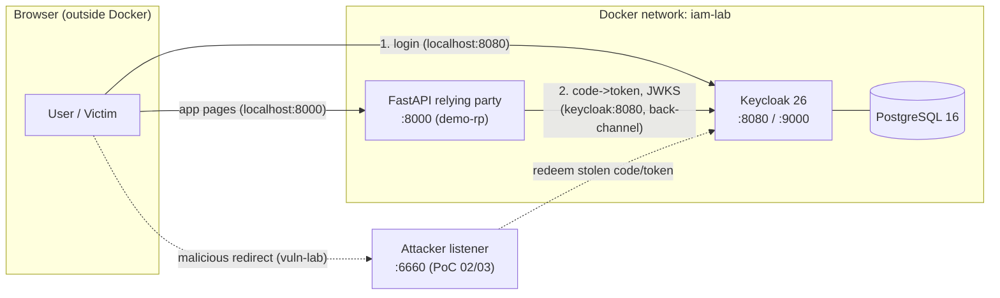

# IAM Attack & Defense Lab - OIDC / OAuth 2.0

A hands-on lab that shows the **same OpenID Connect app built securely and
insecurely, side by side**, then proves four classic OAuth attacks against the
insecure version - and shows the secure version shrug every one of them off.

Built on **Keycloak 26** + **PostgreSQL 16** + a **FastAPI** relying party, all
in Docker, one command to start.

>  **LAB ONLY.** Deliberately insecure by design. Dev-mode Keycloak, plain
> HTTP, weak and publicly-listed credentials, a realm with every guardrail
> switched off. **Never expose this to a network or reuse any of its settings.**

---

**[Full PDF documentation](docs/IAM-Attack-Defense-Lab.pdf)** - a formatted report covering the architecture, both realms, all four attacks (with screenshots), the threat model, and the hardening checklist.

## What's inside

Two Keycloak realms, same users, opposite security postures:

| | `secure-lab` (defense) | `vuln-lab` (offense) |
|---|---|---|
| Client type | confidential (secret) | public (no secret) |
| Redirect URIs | one exact URL | `*` (any) |
| PKCE | required (S256) | not enforced |
| Implicit flow | off | on |
| Direct access grant | off | on |
| Brute-force protection | on | off |
| Self-registration | off | on |

...and four runnable attack PoCs, each defeated by the secure realm:

| PoC | Attack | Script | Defeated by |
|---|---|---|---|
| 01 | Password grant + brute force | [`attacks/01-direct-access-grant.sh`](attacks/01-direct-access-grant.sh) | grant off + lockout |
| 02 | One-click redirect hijack -> account takeover | [`attacks/02-redirect-uri-hijack.py`](attacks/02-redirect-uri-hijack.py) | exact redirect + PKCE + confidential |
| 03 | Implicit-flow token leak in URL | [`attacks/03-implicit-flow-leak.py`](attacks/03-implicit-flow-leak.py) | implicit disabled |
| 04 | No-PKCE code redemption | [`attacks/04-no-pkce.sh`](attacks/04-no-pkce.sh) | PKCE S256 required |

Full write-ups: **[docs/defense.md](docs/defense.md)** (defense) and
**[docs/offense.md](docs/offense.md)** (attacks). Hardening checklist:
**[HARDENING.md](HARDENING.md)**. Threat model & ATT&CK map:
**[docs/THREAT-MODEL.md](docs/THREAT-MODEL.md)**.

---

## Architecture



**The two-URLs detail:** the browser reaches Keycloak as `localhost:8080`; the
app (inside Docker) reaches it as `keycloak:8080`. Keycloak is configured so the
**issuer + login page** stay at `localhost` while **back-channel** endpoints
resolve to `keycloak` - keeping token `iss` consistent. See
[docs/defense.md](docs/defense.md#the-issuer-mismatch-gotcha).

---

## Quick start

Requires Docker + the Compose v2 plugin (`docker compose`). On Ubuntu's distro
Docker the plugin package is `docker-compose-v2`.

```bash
cp .env.example .env            # lab credentials; adjust if you like
docker compose up --build -d    # starts Postgres, Keycloak, the app
docker compose ps               # all three Up; realms auto-import on boot
```

Then open:

| URL | What |
|---|---|
| http://localhost:8000 | the demo app - click **Login with Keycloak** |
| http://localhost:8080 | Keycloak admin console (`admin` / `admin`) |
| http://localhost:8000/idp-check | app -> Keycloak connectivity probe |

**Log in (secure-lab):** `alice` / `alice-password` (user) -
`admin-amy` / `amy-password` (admin - can reach `/admin`).

**Run the attacks (vuln-lab):**
```bash
./attacks/01-direct-access-grant.sh          # terminal only
python3 attacks/02-redirect-uri-hijack.py    # then open the printed link
python3 attacks/03-implicit-flow-leak.py     # then open the printed link
./attacks/04-no-pkce.sh                       # terminal only
```

---

## Lab credentials (both realms)

| User | Password | Roles |
|---|---|---|
| `alice` | `alice-password` | `lab-user` |
| `admin-amy` | `amy-password` | `lab-user`, `lab-admin` |
| `victim` (vuln-lab only) | `Password1` | `lab-user` |
| Keycloak admin | `admin` | - |

All deliberately public. Lab only.

---

## Repo layout

```
docker-compose.yml       Keycloak + Postgres + app, one-command up
.env.example             lab credentials (copy to .env)
app/                     FastAPI OIDC relying party (Authlib)
realms/
  secure-lab-realm.json  hardened realm (auto-imported)
  vuln-lab-realm.json    vulnerable realm (auto-imported)
attacks/                 four runnable attack PoCs (01-04)
docs/
  defense.md          secure design + the issuer-mismatch fix
  offense.md          the four attacks, write-ups + summary table
  THREAT-MODEL.md        threat model & MITRE ATT&CK map
  screenshots/           evidence captures
HARDENING.md             defensive checklist
```

## Tech stack

Keycloak 26.1, PostgreSQL 16, Python 3.12 / FastAPI, Authlib, Docker Compose.

## Credits

Built as a learning project. Attacks and defenses map to the OAuth 2.0 Security
BCP, RFC 7636 (PKCE), and MITRE ATT&CK - see [docs/THREAT-MODEL.md](docs/THREAT-MODEL.md).
