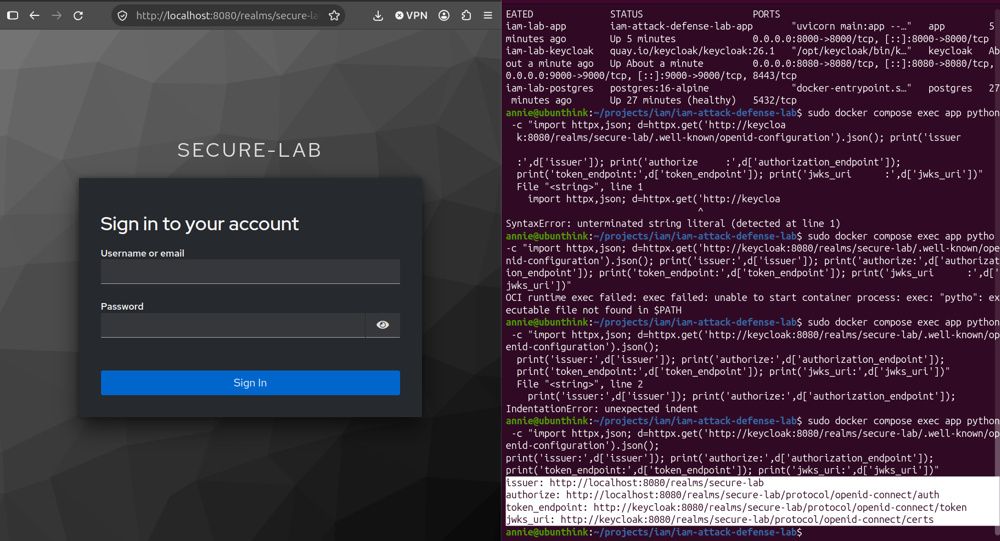
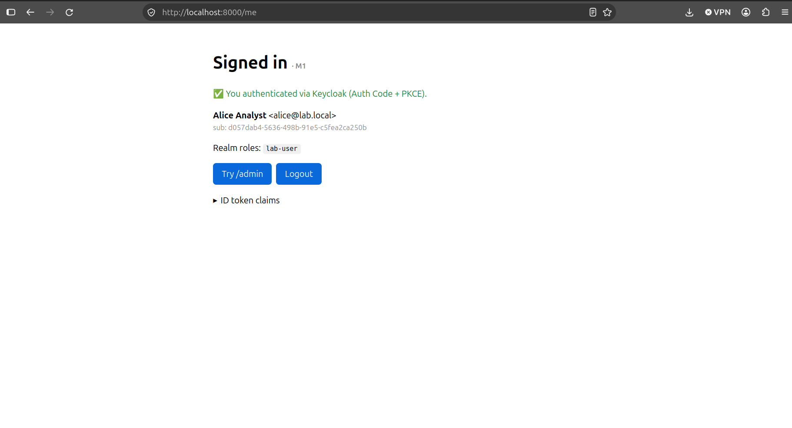
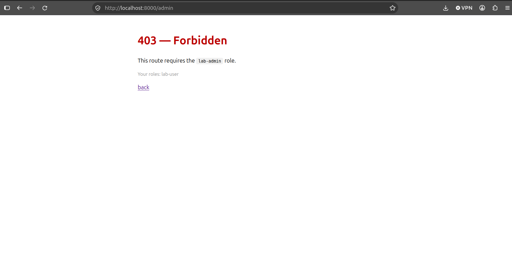
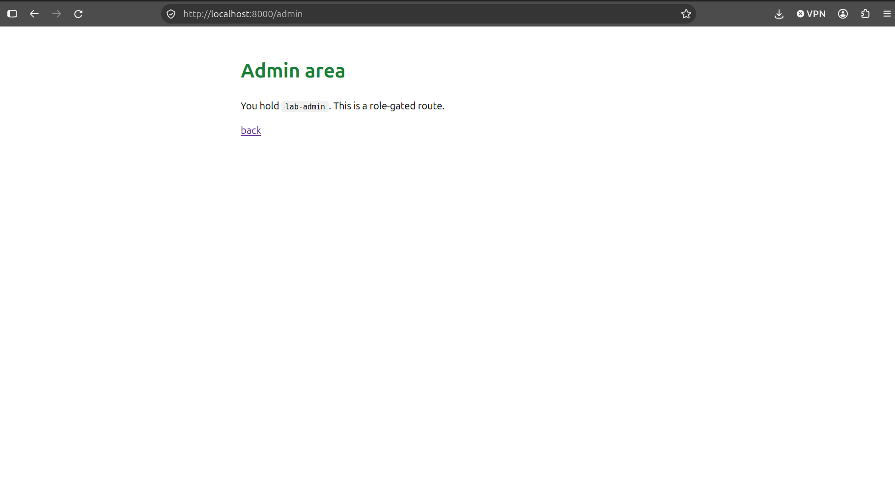

# Defense: the `secure-lab` realm and OIDC relying party

This covers the secure build of the OIDC relying party - the `secure-lab`
realm and the application - done the hardened way, so the attacks in
[offense.md](offense.md) have a baseline to contrast against.

## The login flow in plain words

1. You click **Login** in the app.
2. The app sends your browser to **Keycloak** (`localhost:8080`).
3. You type your username/password **on Keycloak's page** - the app never sees them.
4. Keycloak sends your browser back to the app with a one-time **code**.
5. The app (server-side) swaps that code for **tokens** and checks their signature.
6. The app reads who you are from the token and shows your profile.

This is **OpenID Connect - Authorization Code flow with PKCE**.

## `realms/secure-lab-realm.json` - why each setting

| Setting | Value | Why (security) |
|---|---|---|
| `sslRequired` | `none` | LAB ONLY - we run plain HTTP locally. Production MUST be `external`/TLS. |
| `registrationAllowed` | `false` | No self sign-up. Users are provisioned deliberately. |
| `resetPasswordAllowed` | `false` | Shrinks attack surface (no account-recovery abuse) for the lab. |
| `accessTokenLifespan` | `300` (5 min) | A stolen access token expires fast. |
| `ssoSessionIdleTimeout` | `1800` (30 min) | Idle sessions die. |
| `bruteForceProtected` | `true`, lock after 5 | Basic credential-stuffing defense. |

### The client - `demo-rp`

| Setting | Value | Why |
|---|---|---|
| `publicClient` | `false` (confidential) | App holds a **secret** and swaps the code **server-side**, not in the browser. |
| `secret` | `demo-rp-secret-CHANGE-ME` | Lab secret. Real deployments generate a strong one and keep it out of git. |
| `standardFlowEnabled` | `true` | Authorization Code flow - the safe one. |
| `implicitFlowEnabled` | `false` | Implicit flow leaks tokens in the URL. Off. (Vuln realm will turn it ON.) |
| `directAccessGrantsEnabled` | `false` | No password grant - the app should never handle raw passwords. |
| `redirectUris` | exactly `http://localhost:8000/auth/callback` | **Tight** allow-list. Loose redirect URIs are a classic OAuth hijack bug (see offense.md). |
| `pkce.code.challenge.method` | `S256` | PKCE required - binds the code to the client that started the flow. |

### Test users

| Username | Password | Roles |
|---|---|---|
| `alice` | `alice-password` | `lab-user` |
| `admin-amy` | `amy-password` | `lab-user`, `lab-admin` |

> All credentials here are **lab-only** and deliberately printed. Never reuse.

## The issuer-mismatch gotcha

Keycloak is reachable by **two different names** depending on who's asking:

- Your **browser** reaches it at `http://localhost:8080`.
- The **app container** reaches it at `http://keycloak:8080` (Docker's internal DNS);
  inside the container, `localhost` means the app itself, not Keycloak.

Because we set `KC_HOSTNAME=localhost`, Keycloak stamps every token's `iss`
(issuer) claim as `http://localhost:8080/realms/secure-lab`.

So the app must:
- send the **browser** to `localhost:8080` for the login page, but
- make its own **server-to-server** calls (token swap, fetching signing keys) to
  `keycloak:8080`, while
- still validating the token's `iss` against `http://localhost:8080/realms/secure-lab`.

Mixing these up is the #1 reason a Dockerized OIDC login "mysteriously" fails.

### How we solved it

Two settings on Keycloak (`docker-compose.yml`):

```yaml
KC_HOSTNAME: http://localhost:8080        # MUST be a full URL (not bare 'localhost')
KC_HOSTNAME_BACKCHANNEL_DYNAMIC: "true"
```

- **Frontchannel** (what the browser uses: `issuer`, `authorization_endpoint`)
  stays pinned to `localhost:8080`.
- **Backchannel** (what the app uses: `token_endpoint`, `jwks_uri`) is resolved
  from the host of the incoming request - so when the app calls via
  `keycloak:8080`, it gets `keycloak:8080` back.

The app (`app/main.py`) then just loads discovery from the **internal** URL and
lets Authlib wire everything:

```python
oauth.register(
    name="keycloak",
    server_metadata_url=f"{ISSUER_INTERNAL}/.well-known/openid-configuration",
    ...
)
```

**Proof** (the discovery doc as the app sees it, via `keycloak:8080`):

```
issuer        : http://localhost:8080/realms/secure-lab     <- browser-facing
authorize     : http://localhost:8080/.../auth              <- browser-facing
token_endpoint: http://keycloak:8080/.../token              <- app-facing
jwks_uri      : http://keycloak:8080/.../certs              <- app-facing
```

Browser hits localhost, app hits keycloak, token `iss` = localhost (validates).

> Gotcha we hit: `KC_HOSTNAME_BACKCHANNEL_DYNAMIC=true` with a **bare** hostname
> (`localhost`) crashes Keycloak on boot -
> *"hostname-backchannel-dynamic must be set to false if hostname is not provided
> as full URL."* The fix is the full-URL form shown above.

---

## Screenshots

| | |
|---|---|
| Discovery split (gotcha solved) |  |
| Signed in as alice (Auth Code + PKCE) |  |
| alice denied at /admin (role-gated) |  |
| admin-amy allowed at /admin |  |
